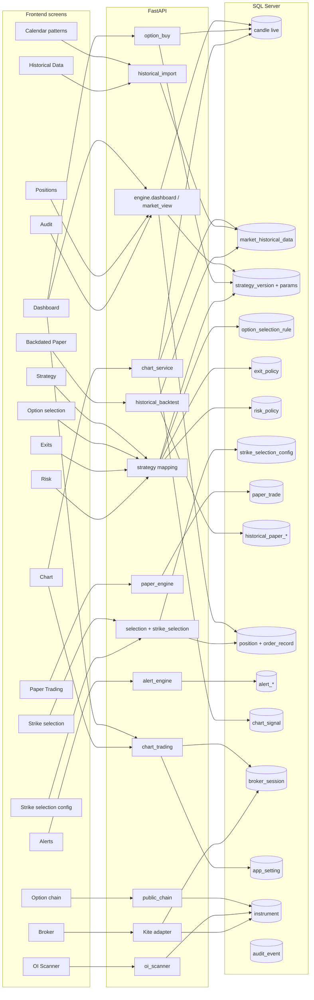
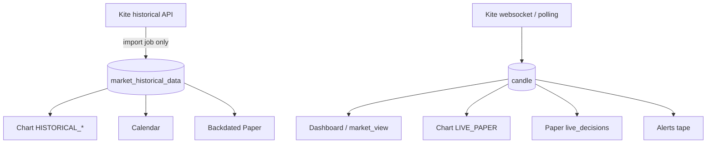
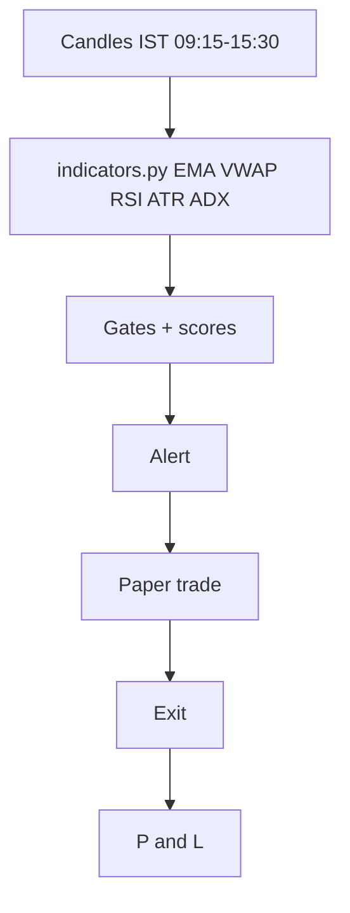
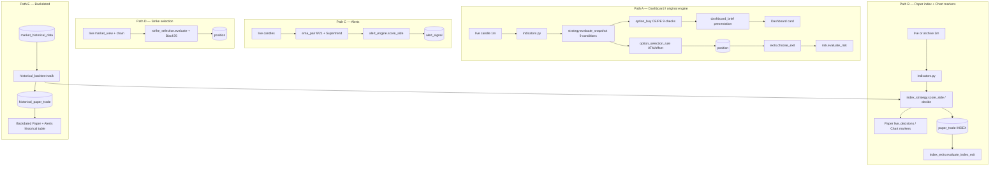
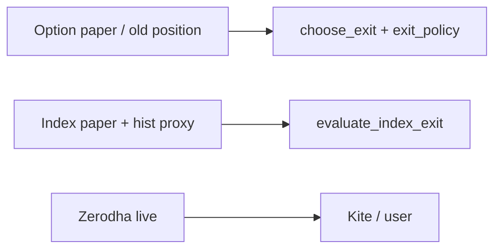
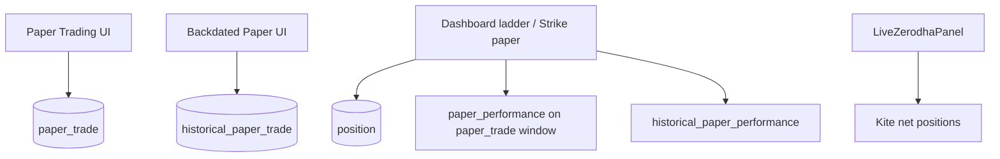
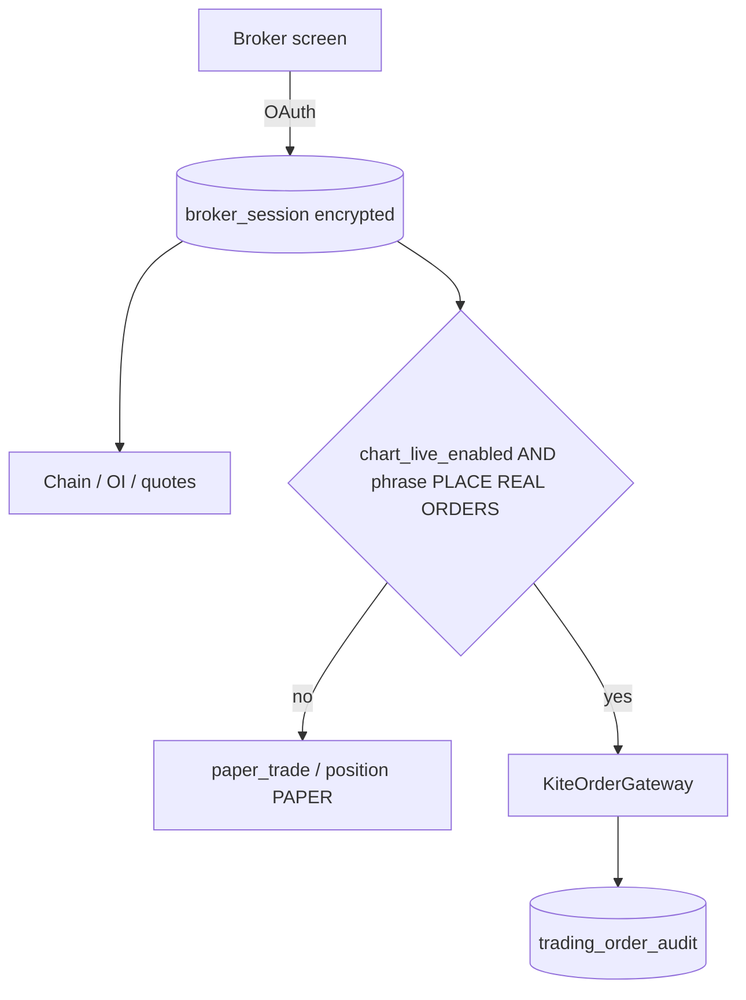

# HexTrade architecture (as built)

Read-only snapshot. Saturday 2026-10-03.

Stack: FastAPI + SQLAlchemy 2 + SQL Server (`localhost\SQLEXPRESS`) on `:8000`. React 18 + Vite on `:5999`. Redis optional (currently **down**). Timezone intended: Asia/Kolkata.

---

## Screens → services → stores

---

## Two candle stores (do not mix)

Rule in code: historical replay must not read live candles. Live Dashboard/Paper/Alerts do not read the archive. That is why **RSI/EMA/ATR disagree** across Dashboard vs Chart historical vs Paper 3m on the same wall-clock time.

---

## Signal flow (intended vs actual)

Intended product story:

**Actual:** that pipeline is implemented **four times**, and the arrows do not all connect.

Nothing in Path C writes a paper trade. Path B does not write Path A `position`. Path E does not update Path B’s today blotter. Live Kite orders (Chart/Dashboard) bypass all of the above and write `trading_order_audit` + the broker.

---

## Scoring copies (which screen uses which)

| Scorer | Function | Screen |
|---|---|---|
| 9 boolean conditions + configured direction | `strategy.evaluate_snapshot` | Dashboard tape votes, Strike “signal”, Chart live condition count |
| CE/PE 9-check percent | `option_buy.evaluate_*` | Dashboard CE/PE blocks |
| Implied trend 3 votes | `dashboard_brief.implied_market_direction` | Dashboard trend glyph; alert tape; paper tape |
| Index groups + mandatory gates | `index_strategy.score_side` / `decide` | Paper panel, Chart hist markers, Backdated walk |
| Alert CE/PE weighted score | `alert_engine.score_side` | Alerts only |
| Strike suitability 0–100 | `strike_selection` weights | Strike selection only |

RSI is one **function** (`indicators.rsi`, Wilder 14) but many **inputs** (1m live vs 3m live vs 3m archive day). Alerts also use EMA9/21, not EMA20.

---

## Exit copies

`exit_policy` (Exits screen) feeds `choose_exit` only. Index structural stop / partial 1R / chandelier lives in `index_exits.py` and is **not** editable on Exits.

---

## P&L ledgers

These four numbers are not reconciled. Verified 2026-10-03: today paper 0; dashboard live-paper −751.28 / 18 trades; hist API run 2 −8021; dashboard hist −9971; positions empty.

---

## Broker / live vs paper

`app_setting.trading_mode` and `chart_live_enabled` are separate latches. Restart is supposed to disarm live; paper mode can still show a live-enable control on Dashboard/Chart.

---

## Expiry

| Consumer | Source |
|---|---|
| Option chain / OI / strike | Listed `instrument.expiry` (live 2026-10-06 Tuesday) |
| Calendar proximity | Listed `instrument.expiry` years &gt; 1990 |
| Index paper / backtest square-off | `is_index_expiry()` weekday heuristic, switch **2024-09-01** |

SENSEX heuristic is Friday. NIFTY heuristic does not match the stated Sept 2025 Thursday→Tuesday change.

---

## Runtime topology (verified)

- API `:8000` — health `ok`, database `up`, redis `down`, trading_loop `running`
- UI `:5999` — Vite index contains HexTrade
- Session closed (Saturday)
- Broker connected, mode PAPER, kill switch off, live trading badge off
